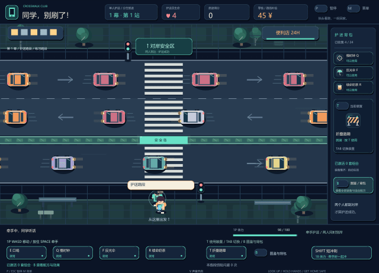

# 同学，别刷了！

护送一个沉迷手机、偶尔不听指挥的同学过马路。在车流里找空隙，用牵手、口哨和装备组合把两个人安全带到对岸。

**0.4.0 · 街头行动版**是原生 Windows 桌面游戏，使用 WinForms 与 GDI+ 绘制。无需浏览器或联网，支持 Windows 10 / 11，依赖系统 .NET Framework 4.x。

[下载完整游戏包](releases/同学别刷了_街头行动版.zip) · [查看程序入口](game/同学别刷了.exe)

请优先下载完整游戏包，单独下载 EXE 会缺少图片和音效资源。



预览由游戏绘图指令逐帧生成，并非实际启动程序后的录屏。

## 快速开始

1. 下载并完整解压 ZIP，进入「同学别刷了_街头行动版」文件夹。
2. 双击「同学别刷了.exe」，保留同目录的 `assets` 文件夹，其中包含图片、图标和本地音效。
3. 按 `1` 选择单人，或按 `2` 选择本地双人，再按 `Enter` 出发。
4. 先挑选装备。单人在地图选择下一站；双人依次选完装备后开始对抗。

当前旅程不保存到磁盘，关闭程序后需要重新开始。详细规则和全部配方见游戏包内「文档/操作与组合说明.md」。

## 单人：选一条回家的路

单人采用《杀戮尖塔》式分岔路线：三幕、每幕六站，共十八站。沿相邻路线选择护送、精英、事件、商店和休息节点，各幕最后汇入特殊首领路口。生命、金币和装备沿途保留，受伤会回到最近通过的安全岛。

校门车队会预告提速波次，施工路口要求绕开隔离带，连播路口让车道交替通行，也会让同学分心。越往后，车流和护送压力越大。

共有 **24 件独有装备、20 套组合，没有升级系统**。每件装备最多获得一次；集齐对应两件装备就自动激活组合，多套组合可以同时生效。被动装备获得后自动生效，主动道具需要按对应按键使用。路障、信号遥控器、奶茶诱饵和无人机也能与原有装备搭配。

街头行动版增加平滑移动、短冲刺、人物步态与朝向、手机刷屏、车轮与速度线、技能波纹、冲刺残影、碰撞震动和六种本地音效。移动中惊险擦过车辆并等它安全通过后，单人可获得 **15 分、2 金币、6 体力**，每辆车只结算一次，停车装置中的车辆不能用来刷奖励。

## 本地双人：一个护送，一个捣蛋

两人共用同一键盘。1P 要把双方带到对岸；2P 控制玩手机的同学，利用挣脱和捣蛋道具阻止护送。

每局 **75 秒，三局两胜**。1P 带双方抵达对岸即可赢得本局；超时或 1P 生命耗尽，则 2P 赢得本局。2P 撞车会失去能量并短暂眩晕。

双人也取消升级，1P 有 12 件独有装备，2P 有 8 件独有装备。分岔地图、T 装置和 B 图鉴用于单人旅程。

## 操作

| 玩家 / 场景 | 按键 | 操作 |
| --- | --- | --- |
| 菜单 | `1 / 2`、`Enter` | 选择单人 / 双人并出发 |
| 1P | `W A S D` | 移动；单人也支持方向键 |
| 1P | 按住 `空格`、`E` | 牵手、口哨 |
| 1P | `Shift` | 短冲刺，消耗 18 体力，冷却 1.4 秒 |
| 1P | `Q / F / R` | 慢时钟 / 反光伞 / 奶茶，需先获得 |
| 单人 | `T / Tab` | 使用 / 轮换已获得的装置，装置共享冷却 |
| 单人 | `B`、`Tab`、左右键 | 打开图鉴与背包、切换类型、翻页；B 或 Esc 返回 |
| 地图 / 三选一 | `1 / 2 / 3` 或左右键 + `Enter` | 选择路线、装备或方案，也可用鼠标 |
| 商店 | `1 / 2 / 3`、`0` | 购买商品、离开商店 |
| 2P | 方向键、`Enter` | 移动、挣脱 |
| 2P | `J / K / L` | 假通知 / 横滑闪避 / 耳机，需先获得 |
| 公共 | `V` | 开关声音 |
| 公共 | `F11` | 进入 / 退出全屏 |
| 公共 | `P / Esc`、`M` | 暂停 / 恢复、返回菜单 |
| 结束 | `Enter / N` | 同种子重试 / 新种子开始 |

Shift 按当前方向冲刺，没有方向输入时按上次朝向冲刺；牵手时同学一起冲。冲刺仍会撞车，请先观察车流。窗口失去焦点会自动暂停，回来后按 Enter 或 P 恢复。暂停和查看背包时，道路、冲刺冷却、粒子及道具时间冻结；V 只控制声音。

## 验证状态

已进行玩法 CIL 模拟、界面绘制、资源、EXE 结构和框架调用检查。制作环境的自动审批禁止启动桌面进程，**尚未实际启动 Windows 窗口试玩**。验证记录见游戏包内「文档/验证说明.md」。

## 从源码构建

需要 Node.js 20 或更新版本，在仓库根目录运行：

```powershell
npm test
npm run build
```

无需安装依赖。构建输出为 `dist/同学别刷了_街头行动版/` 和同名 ZIP。构建与检查不会启动游戏；详细结构见 [构建说明](docs/构建说明.md)。
